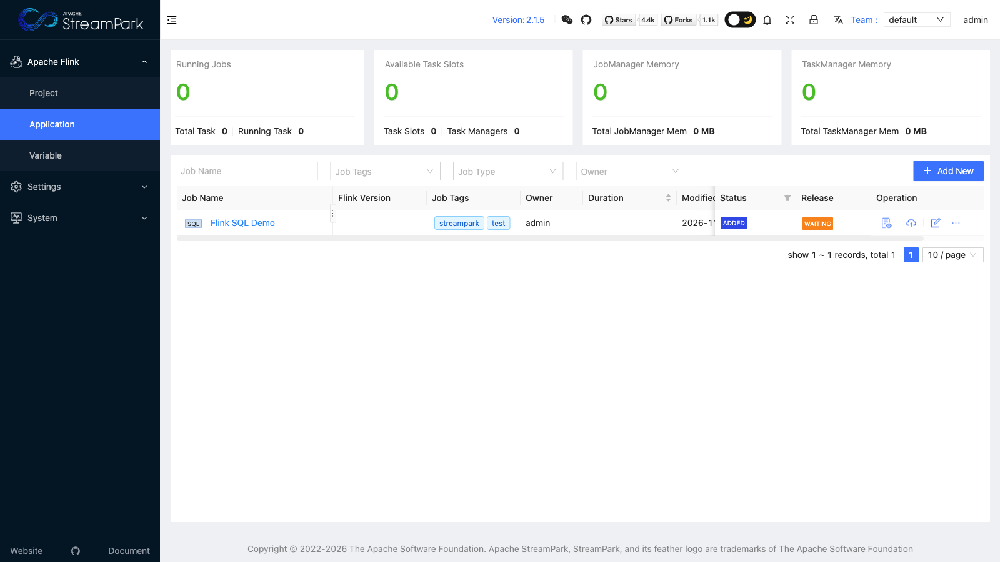
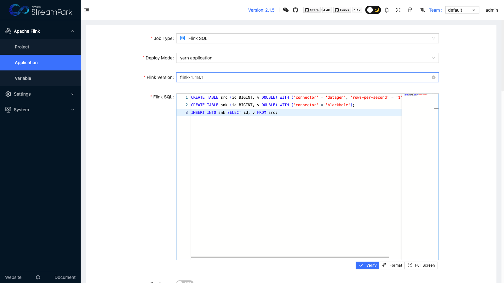
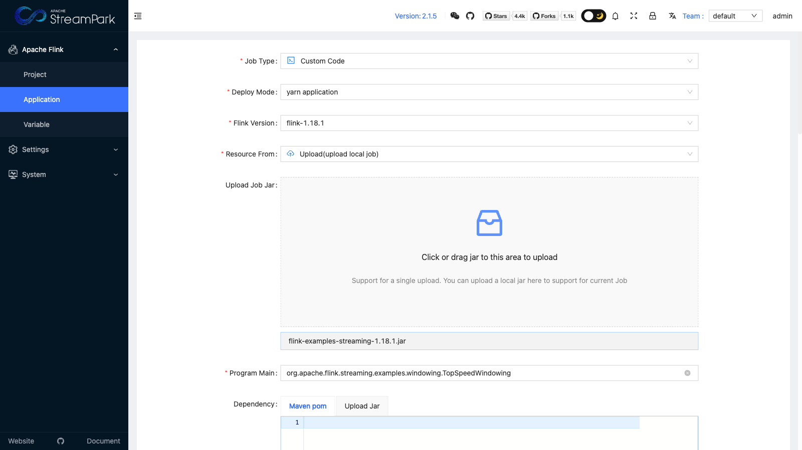
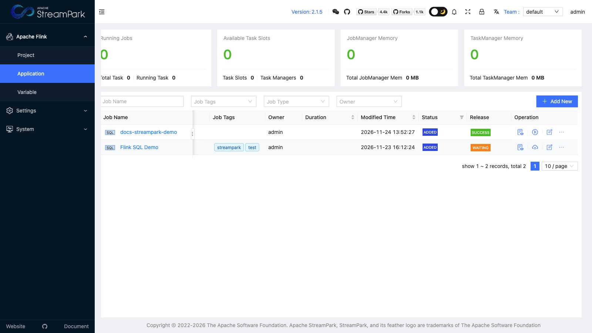
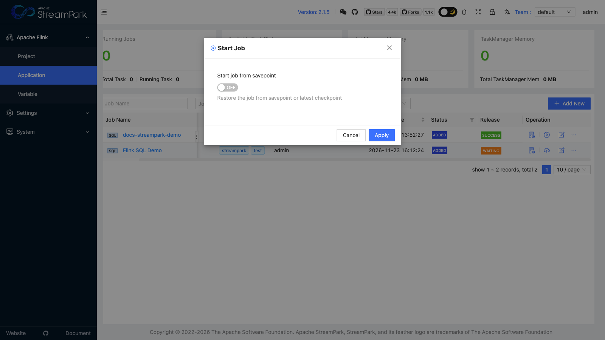
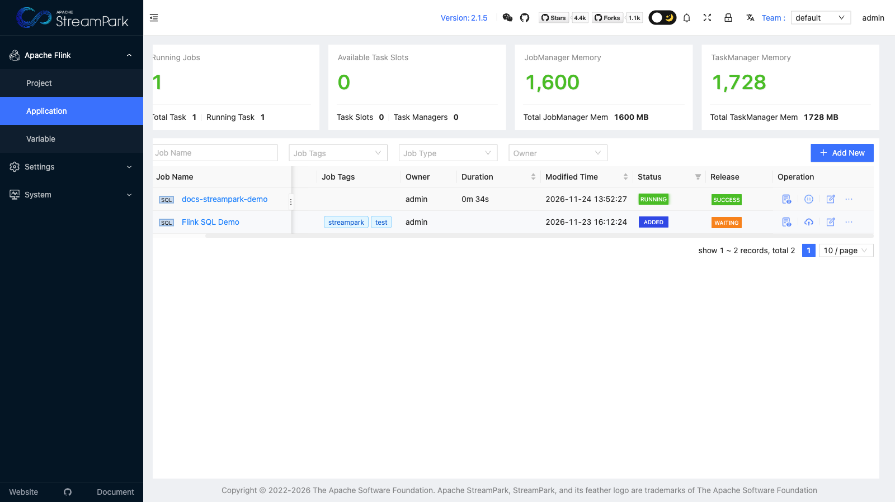
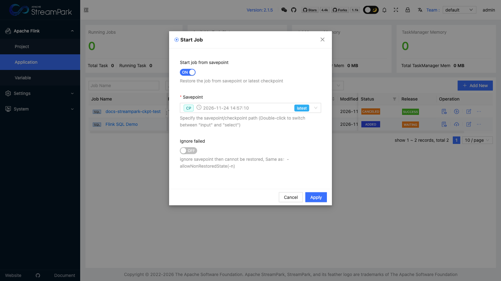
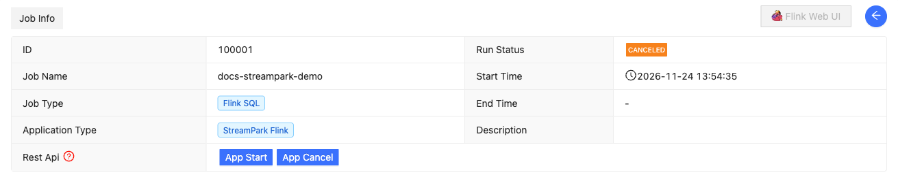
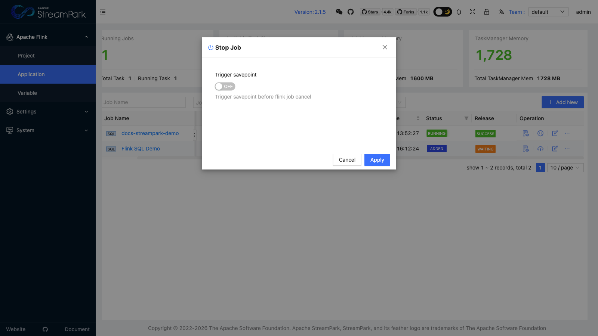
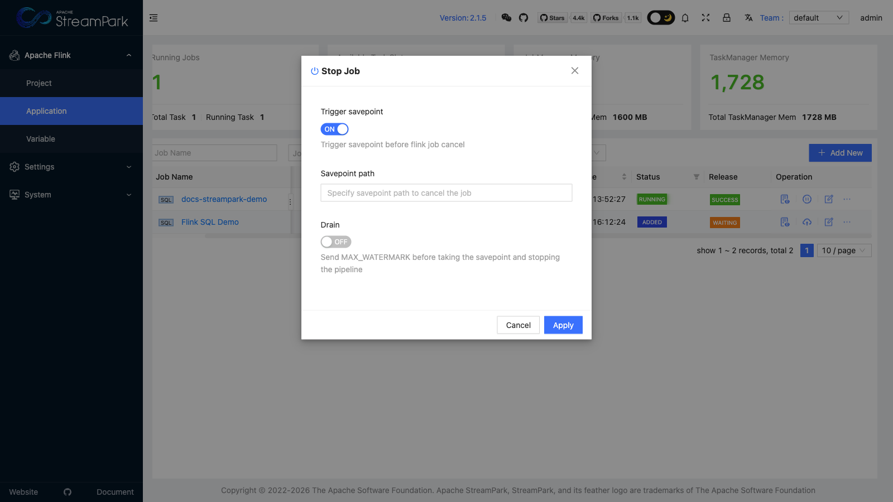

# StreamPark开发指南

## 1. 基本介绍

**Apache StreamPark** 是一个流处理应用开发管理平台，提供 Web 控制台，可用于 Flink 作业的开发、编译、部署、启停和监控。详细见 [Apache StreamPark](https://streampark.apache.org/)。

UHadoop 中的 StreamPark 与 Flink 配合使用，作业以 Flink On Yarn 方式运行。

## 2. 服务说明

| 项目         | 说明                                                         |
| ------------ | ------------------------------------------------------------ |
| 安装目录     | `/home/hadoop/streampark`                                    |
| 配置文件     | `/home/hadoop/streampark/conf/config.yaml`                   |
| Web 端口     | 11000                                                        |
| 本地工作空间 | `/data/streampark/workspace`，用于存放项目代码和编译产物     |
| HDFS 工作空间 | `hdfs://Ucluster/streampark/`，用于存放作业依赖的 JAR 包     |
| 日志目录     | `/var/log/streampark`                                        |
| 运行节点     | master1                                                      |
| 运行用户     | `hadoop`：StreamPark 服务进程以 `hadoop` 用户运行；提交到 Yarn 的作业也使用该用户（对应配置 `streampark.hadoop-user-name`），访问 HDFS 时使用 `hadoop` 用户的权限 |
| 登录用户     | 用户名 `admin`，密码为集群密码                               |

说明：

* 集群创建时同时部署了 Flink 的，Flink 版本会被自动注册到 StreamPark 的 Flink 环境中，其中第一个版本为默认版本，无需手动添加。
* 访问 Web 控制台的方式参考[UHadoop服务WebUI接入指南](/uhadoop/developer/webui) ，服务端口为 11000。

## 3. 服务管理

可在 master1 节点使用 `service` 命令管理 StreamPark 服务：

```
# 启动
service StreamParkServer start

# 停止
service StreamParkServer stop

# 重启
service StreamParkServer restart

# 状态检查
service StreamParkServer status
```

说明：请使用 `hadoop` 用户执行以上命令。

## 4. 提交 Flink 作业

### 4.1 登录控制台

StreamPark 运行在 master1 节点，访问 `http://uhadoop-xxxxxxx-master1:11000`，使用 `admin` 用户登录，密码为集群密码。

登录后，在左侧菜单依次选择 **Apache Flink** > **Application**（应用）进入应用列表，列表中展示作业名称、Flink 版本、运行状态（Status）和发布状态（Release）等信息，页面顶部展示运行中作业数、内存等集群概览。



### 4.2 创建作业

在应用列表右上角点击 **Add New**（添加），进入作业创建页面。下面按 Job Type（作业类型）分别介绍两种场景。

两种场景共用的说明：

* **Deploy Mode**（部署模式）推荐使用 **yarn application**。
* **Job Name**（作业名称）仅支持中英文、`-` 和 `_`，且不能出现连续两个空格。
* 建议在 **Dynamic Properties**（动态参数）中配置以下参数，开启 Checkpoint 并在作业取消后保留，以便后续从 Checkpoint 恢复作业：

  ```
  -Dexecution.checkpointing.interval=60s -Dexecution.checkpointing.externalized-checkpoint-retention=RETAIN_ON_CANCELLATION
  ```

  Checkpoint 默认保存在 `hdfs://Ucluster/flink/flink-checkpoints/<jobId>/chk-<n>`，无需额外配置目录。


#### 4.2.1 Flink SQL 作业

1. **Job Type** 选择 **Flink SQL**。
2. 选择 Deploy Mode 和 Flink Version。
3. 在 **Flink SQL** 编辑器中编写 SQL，点击 **Verify**（校验）检查语法，校验通过后提示 `Verification success`。以下示例使用内置的 `datagen` 连接器生成数据，写入 `blackhole` 连接器，仅用于验证作业能够正常提交和运行：

   ```
   CREATE TABLE src (id BIGINT, v DOUBLE) WITH ('connector' = 'datagen', 'rows-per-second' = '1');
   CREATE TABLE snk (id BIGINT, v DOUBLE) WITH ('connector' = 'blackhole');
   INSERT INTO snk SELECT id, v FROM src;
   ```

4. 填写 Job Name，点击页面底部的 **Submit**（提交）。

完整表单如下：



#### 4.2.2 Custom Code 作业

Custom Code 用于提交已经开发好的 Flink JAR 包。

1. **Job Type** 选择 **Custom Code**。
2. 选择 Deploy Mode 和 Flink Version。
3. **Resource From**（资源来源）选择 **Upload (upload local job)**（上传本地 JAR）。
4. 在 **Upload Job Jar** 区域点击或拖拽上传 JAR 包，仅支持单个文件，上传后文件名显示在上传区下方。
5. 在 **Program Main** 中填写 JAR 包的主类全名（必填）。
6. 如作业依赖额外的类库，可在 **Dependency** 中通过 **Maven pom** 或 **Upload Jar** 添加；作业所需的启动参数可填写在 **Program Args** 中。
7. 填写 Job Name，点击页面底部的 **Submit**（提交）。

以下示例上传 Flink 官方示例包 [flink-examples-streaming-1.18.1.jar](https://repo1.maven.org/maven2/org/apache/flink/flink-examples-streaming/1.18.1/flink-examples-streaming-1.18.1.jar)，主类使用 `org.apache.flink.streaming.examples.wordcount.WordCount`：



说明：

* 上传的 JAR 需自带作业所需的依赖（fat jar），Flink 发行版已提供的类库无需重复打包，其余依赖缺失会导致作业启动失败。
* 作业创建成功后，状态为 `ADDED`，发布状态为 `WAITING`。之后的发布、启动、停止操作与 Flink SQL 作业相同。
* WordCount 示例是有界作业，启动后运行数秒即正常结束，状态为 `FINISHED`，不会一直处于 `RUNNING`。

### 4.3 发布作业

新创建的作业需要先发布，才能启动。

* 在应用列表中点击作业所在行的 **Release Job**（发布，云上传图标），页面提示 `Current job is releasing`，等待数秒。

* 发布完成后，发布状态变为 `SUCCESS`，原发布图标变为启动图标。

  

说明：作业被编辑（Edit）并保存后，发布状态会重新变为 `WAITING`，需要再次发布后才能启动。

### 4.4 启动作业

* 点击作业所在行的 **Start Job**（启动，播放图标），弹出启动对话框。

  

* 首次启动时没有可恢复的记录，**Start job from savepoint**（从 Savepoint 启动）保持 OFF，点击 **Apply**（确定）。

* 启动成功后，作业状态变为 `RUNNING`，并开始累计运行时长（Duration），页面顶部的 Running Jobs 同步增加。

  

作业运行并产生 Checkpoint 或 Savepoint 后，再次点击 **Start Job** 时，对话框会默认打开 **Start job from savepoint**（从 Savepoint 启动）开关，并自动选中最近一次的记录：



| 配置项           | 说明                                                         |
| ---------------- | ------------------------------------------------------------ |
| Savepoint        | 必填，下拉列表中展示已记录的 Savepoint 和 Checkpoint，`CP` 表示 Checkpoint，`latest` 标记最近的一条。双击输入框可切换为手动输入路径 |
| Ignore failed    | 选填，开启后忽略无法恢复的状态，等同于 Flink 的 `--allowNonRestoredState`（`-n`）参数 |

说明：

* 作业启动后，可在 Flink Web UI 的 Checkpoints 页面查看恢复信息。
* 如需全新启动、不恢复状态，请将 **Start job from savepoint** 开关关闭后再点击 **Apply**。
* 要让作业产生可恢复的 Checkpoint，需要在创建作业时开启 Checkpoint 并设置取消后保留，详见 4.2。
* Savepoint 和 Checkpoint 也可以手动获取，参考[Flink FAQs](/uhadoop/user/flink)。

### 4.5 查看作业

点击应用列表中的作业名称，进入作业详情页，可查看作业基本信息（Job Info）、操作记录（Operation Log）、作业选项（Option）和 Flink SQL。



* 作业运行中时，点击右上角的 **Flink Web UI** 可跳转到该作业的 Flink 页面。
* 操作记录中的 Cluster Id 即作业在 Yarn 上对应的 Application ID，也可通过 Yarn WebUI 查看，访问方式参考[UHadoop服务WebUI接入指南](/uhadoop/developer/webui)。

### 4.6 停止作业

* 点击作业所在行的 **Stop Job**（停止）图标，弹出停止对话框。

  

* 直接停止：保持 **Trigger savepoint**（触发 Savepoint）为 OFF，点击 **Apply**，作业状态变为 `CANCELED`。

* 停止前保存 Savepoint：打开 **Trigger savepoint** 开关，可设置以下参数后点击 **Apply**：

  

  | 配置项          | 说明                                                         |
  | --------------- | ------------------------------------------------------------ |
  | Savepoint path  | 选填，Savepoint 保存在默认路径 `hdfs://Ucluster/streampark/savepoints/` 下，形如 `savepoint-xxxxxx-xxxxxxxxxxxx` |
  | Drain           | 开启后，在触发 Savepoint 并停止作业前，先发送 `MAX_WATERMARK`，使窗口等算子输出剩余数据 |

## 5. 常用配置

StreamPark 的配置在 `/home/hadoop/streampark/conf/config.yaml` 中，修改后需重启服务生效，常用配置如下：

| 配置项                        | 说明                                                         |
| ----------------------------- | ------------------------------------------------------------ |
| `server.port`                 | Web 服务端口，默认 11000                                     |
| `server.session.ttl`          | 登录会话有效期，默认 2h，超时需重新登录                      |
| `streampark.workspace.local`  | 本地工作空间，不可设置在 StreamPark 安装目录下               |
| `streampark.workspace.remote` | HDFS 工作空间                                                |
| `streampark.hadoop-user-name` | 提交作业到 Yarn 使用的用户，默认 `hadoop`                    |
